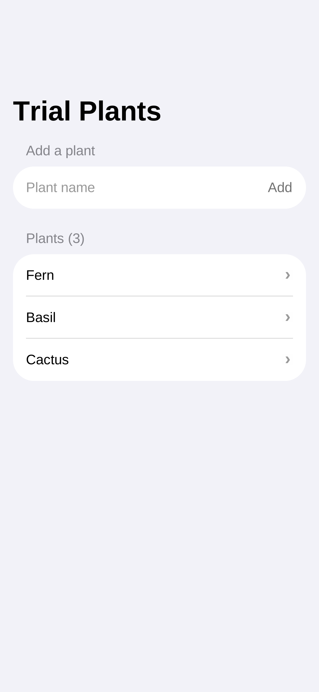
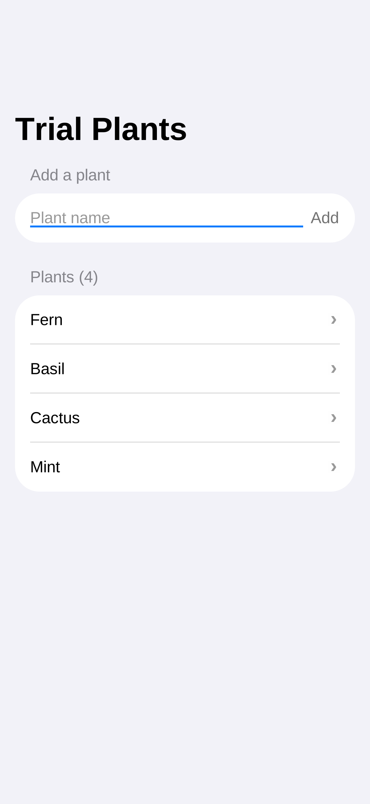
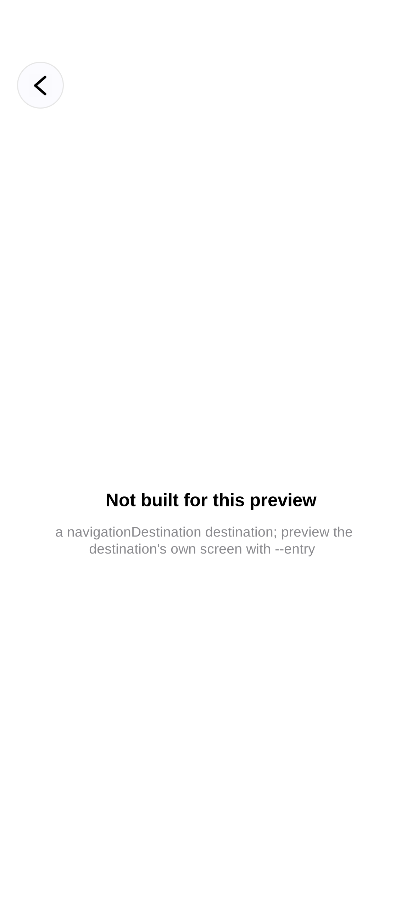
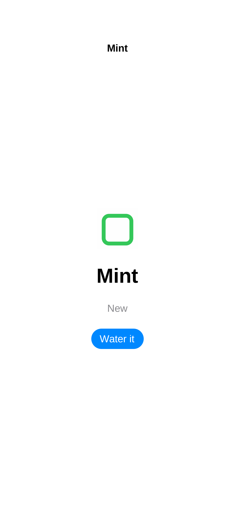
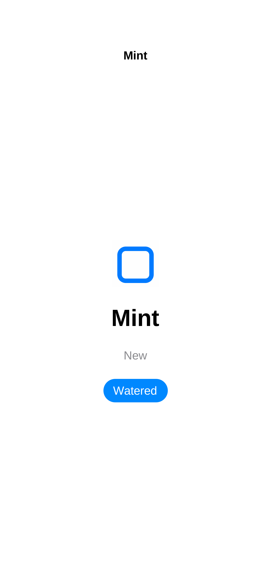

# mobai-dev trial report

Run date: 2026-10-12 (UTC). Installed version: `mobai-dev 1.3.4 (c8779a78, 2026-10-07T21:54:52Z)`.
Environment: Claude Code cloud sandbox (Linux amd64), HTTPS via a loopback proxy, `MOBAI_SKIP_TAILSCALE=1`.

## Verdict

The device-free SwiftUI preview works and is fast: after about 2 minutes of one-time setup (plus a Swift toolchain
the brief did not mention), a preview starts in about 5 seconds, taps and typing work by label, and state changes
(add a plant, "Water it" flips to "Watered") are reflected. It is not iOS. It is a Linux re-implementation drawn with cairo, it
could not show a pushed screen via normal navigation, and SF Symbols rendered as blue squares because I declined to
accept Apple's design-font licenses on Sam's behalf. The build and simulator paths (tests 5 to 7) did NOT work from this sandbox:
the sandbox's GitHub credentials can neither dispatch workflows (404) nor push tags (403), and the tool itself pushed an
unrequested snapshot branch to the repo before failing. I saw nothing malicious locally (the API binds to 127.0.0.1,
the generated workflows are ordinary), but my network capture could not see mobai-dev's remote hosts (details under
test 2 and 8), so "behaves safely on the network" is NOT established by this trial. Tests 6 and 7 were not run.

## Results

Times are UTC on 2026-10-12.

| # | Test | Result | Start to end | Evidence |
|---|------|--------|--------------|----------|
| 1 | Install record | PASS | 19:05:56 to 19:05:56 | `--version` = 1.3.4, same as the brief, so no self-upgrade observed (I did not run `mobai-dev update`). `~/.claude/settings.json` has one SessionStart hook: `/root/.mobai/bin/mobai-hook` (prints static hints, curls `127.0.0.1:8686/api/v1/devices`). `~/.codex/AGENTS.md` is a short instruction block steering agents to mobai-dev. Skills are copied to `~/.claude/skills` and `~/.agents/skills`. `~/.mobai/bin` holds `mobai-dev` (89 MB), `tailscale`, `tailscaled`, `mobai`, `mobai-up`, `mobai-hook`. |
| 2 | Network baseline | PARTIAL, blind to mobai-dev | 19:05:29 to 19:32:22 | `ss` and `tcpdump` are not installed. I sampled `/proc/net/tcp` every 5 s (ESTABLISHED and SYN_SENT). Limits: (a) the proxy is `127.0.0.1:33885`, so mobai-dev's HTTPS shows only as loopback connections and the real destinations are hidden; (b) 5 s sampling misses short connections. The long-lived remote connections seen all belong to the `claude` harness process. Reverse DNS returned nothing for any IP. |
| 3 | Local API auth | PASS (nothing sensitive to expose, no devices) | 19:15:42 to 19:15:50 | Listener is `127.0.0.1:8686` only (lsof). With no credentials: `GET /api/v1/devices` 200 `[]`; `GET /api/v1/apis` 200 `[]`; `GET /api/v1/health` 200 with `{"deviceCount":0,"hostname":"vm","node_id":"","requireDeviceClaim":false,"service":"mobai","sharing":false,"status":"ok",...,"version":"1.3.4"}`; `GET /mcp` 200 with empty body; `POST /api/v1/devices/claim` 409 "no devices are connected". `requireDeviceClaim` is false. Caveat: no phone was connected, so I could not test what an unauthenticated caller could do to a real device. Any local process in the sandbox can call this API. |
| 4 | Preview | PASS WITH WORKAROUNDS | 19:15:56 to 19:19:59 | See "Test 4 detail". Setup 5 s; engine install 31 s; Swift 6.3.3 install about 74 s (after a failed first attempt); preview ready in about 5 s. |
| 5 | Build (`build --ios`, unsigned) | FAIL | 19:20:11 to 19:20:28 (17 s) | `AUTH_REQUIRED`: dispatch of `ios-build.yml` returned 404 for the sandbox's GitHub credentials. The tool had already pushed branch `mobai-dev/snapshot/22bced6c` to `SZoloth/mobai-trial`. Sam approved the tag fallback; `git push origin ios-build/22bced6c` at 19:24:35 was refused with HTTP 403 and the tag is not on the remote. No artifact exists. Even with a run, the sandbox cannot download artifacts (GitHub API blocked). |
| 6 | Simulator | NOT RUN | n/a | Depends on the same GitHub dispatch path as test 5, which was refused, and on the `MOBAI_API_KEY` repo secret, which Sam has not added. I did not attempt `sim start`, to avoid pushing another snapshot branch for a result I expected to be the same failure. That expectation is a guess, not an observation. |
| 7 | Fidelity | NOT RUN | n/a | Needs test 6 screenshots. |
| 8 | Network report | PARTIAL | see below | Host list is assembled from tool output and text, not from the capture. |

### Test 4 detail

Flow requested: screenshot list, add "Mint", open it, tap "Water it", screenshot.

1. `mobai-dev setup --agent claude --framework swiftui` wrote `.mobai/config.json` and `.claude/skills/previewing-mobile-apps/*`, and reported `ready: no`: Swift MISSING, engine MISSING, adapters catalog MISSING.
2. `mobai-dev adapters update` worked. The codeload tarball returned 403 and it fell back to a git clone from GitHub (79 files).
3. `mobai-dev engines install swiftui` downloaded 132.5 MB from the GitHub release `v1.3.4`, then its bootstrap failed: "No Swift toolchain found".
4. Swift install is a prerequisite the brief did not mention. `swiftly` from `download.swift.org` failed on gpg key import behind the proxy (`gpg --import` exit 2, the proxy-gzip problem the tool's own note describes). Importing `swift.org/keys/all-keys.asc` by hand did not help because swiftly re-fetches the key itself. I then used `swiftly install 6.3.3 --no-verify`, which means **the toolchain was installed without signature verification (TLS only)**. The engine install then succeeded.
5. `preview run --detach` with no entry fails (`PREVIEW_ENTRY_REQUIRED`). `--entry ContentView` works. The renderer is `cairo (DEGRADED: SF Pro is not fetched)`. The fix requires `MOBAI_ACCEPT_APPLE_DESIGN_LICENSES=1`, i.e. accepting Apple's license terms, which I did not do on Sam's behalf.
6. On `ContentView`: list screenshot, typed "Mint" into the field, tapped Add. The semantic tree showed "Plants (4)" and a "Mint" row (`shots/preview-2-after-add.png`). Taps and typing by text worked.
7. Tapping the "Mint" row opened a placeholder, **"Not built for this preview: a navigationDestination destination; preview the destination's own screen with --entry"**. "Water it" does not exist in that screen, so the requested flow cannot be done in one preview session (`shots/preview-3-detail.png`).
8. Workaround: preview `PlantDetail` directly. That needs a supplement file giving `PlantDetail` an argument-free init. The engine's error says to write it at `.mobai/preview/swiftui/sources/TrialApp/PlantDetailPreviewEntry.swift`; the skill doc says `sources/<ScreenName>/`. Bare `--entry PlantDetail` kept failing its pre-check (`PREVIEW_ENTRY_ARGS_REQUIRED`) with the supplement present at either path. `--entry TrialApp/TrialApp.swift#PlantDetail` with the supplement at the `TrialApp/` path worked. So the error text was right about the path and the pre-check is wrong for the bare-name form. The supplement hard-codes `Plant(name: "Mint", note: "New")`, so this screen is not the real "Mint" row, it is a stand-in for it.
9. On `PlantDetail`: tapped "Water it", the button became "Watered" and the tint changed (`shots/preview-3-detail-direct.png`, `shots/preview-4-watered.png`).

Rendered wrong or missing: the SF Symbol (`leaf` / `drop.fill`) draws as a plain blue rounded square, and the semantic tree calls it `Text "[square]"`. No status bar, no keyboard, system font is a Liberation-style fallback (Helvetica-like), not SF. The text field shows a blue focus underline after the tap.

## Screenshots

All 1179 x 2556.

- List: `shots/preview-1-list.png`
- After adding Mint: `shots/preview-2-after-add.png`
- Row opened through navigation (placeholder): `shots/preview-3-detail.png`
- Detail, direct entry: `shots/preview-3-detail-direct.png`
- After "Water it": `shots/preview-4-watered.png`

## Hosts (test 8)

IMPORTANT: the capture could not attribute traffic to mobai-dev (loopback proxy, 5 s sampling). The list below comes from
tool output, error messages and workflow text. Treat "contacted" as "the tool said or implied it did". Absence from this list is not evidence of absence.

Raw capture (remote IPs seen on non-loopback sockets, whole session):

| IP | Seen | Owner (inferred, not resolved) | On brief list? |
|----|------|-------------------------------|----------------|
| 160.79.104.10:443 | whole session | Anthropic API (the `claude` process) | yes |
| 140.82.112.5:443 and 140.82.114.5:443 | whole session | GitHub (the `claude` process) | yes |
| 34.149.66.165:443 | whole session | Google Cloud range, owner unknown (the `claude` process) | UNKNOWN |
| 91.189.91.81:80 | once, 19:18:40, during the engine bootstrap | Canonical / Ubuntu archive (plain HTTP). Initiating process not identified | **NO** |

By step, from tool output:

| Step | Host | Source of evidence | On list? |
|------|------|--------------------|----------|
| Login | Supabase (OTP send and verify; log says `component=supabase`) | mobai-dev log lines. Host name not printed, so I cannot confirm it is `pdomnyovfhqsjhgtixub.supabase.co` | probably |
| mobai-up | mobai.run (not directly observed). The server started with no tailnet | n/a | n/a |
| 4 adapters | `codeload.github.com` (403), then `github.com` git clone | tool output | yes (`*.githubusercontent.com` / github.com) |
| 4 engine | `github.com/MobAI-App/mobai-dev/releases/download/v1.3.4/swiftui-linux-x64.tar.gz` | tool output | yes |
| 4 engine bootstrap | `91.189.91.81:80` (Canonical) | capture | **NO** |
| 4 toolchain | `download.swift.org` (swiftly + toolchain), `swift.org` (keys) | my commands | **NO** (brief did not mention Swift) |
| 5 build | `github.com` (snapshot branch push, workflow dispatch API, tag push) | tool output, git ls-remote | yes |
| Workflows (not run) | `bun.sh/install` (curl piped to bash, JS projects only); action `MobAI-App/mobai-ci@v1` | workflow text | `bun.sh` **NO** |

Not contacted by my own tests: tailscale.com, deviceboxhq.com, gs.apple.com. Not checked: whether mobai-dev contacted `mobai.run`.

## Surprises

1. **Unrequested push.** `build --ios` pushed the whole working tree as `mobai-dev/snapshot/22bced6c` to `SZoloth/mobai-trial` before it knew it could dispatch, and left it there after failing. Cleanup: `git push origin --delete mobai-dev/snapshot/22bced6c`.
2. **Build and simulator are effectively unreachable from this sandbox.** The sandbox token cannot dispatch (404) or push tags (403). The tool's fallback ends in a step the sandbox cannot do. The tool should say this up front.
3. **Swift toolchain is a hidden prerequisite**, and getting it behind this proxy needed `--no-verify`.
4. **Error hint vs behavior mismatch** for preview supplements (test 4, step 8).
5. **Placeholder instead of navigation.** A basic `NavigationStack` plus `navigationDestination` flow cannot be previewed end to end.
6. **Degraded rendering by default**, fixable only by accepting Apple font licenses.
7. **Generated workflows** (`ios-build.yml` 1340 lines, `ios-share.yml` 692 lines): no `permissions:` block, a third-party action on a mutable tag (`MobAI-App/mobai-ci@v1`), `curl | bash` for bun. They reference many signing secrets and `MOBAI_API_KEY`; an unsigned build uses none. I did not add any signing material or any secret.
8. **Login code expiry.** The emailed code was rejected as expired after about 2.5 minutes, and resend is rate limited to 30 s. This was partly my latency.
9. **Rules held.** No signing certificates, no Tailscale or phone setup (`MOBAI_SKIP_TAILSCALE=1` kept), no secrets added, no binary decompiled, every log stream time-limited. One command of mine (proxy status curl) was blocked by the harness's classifier and I did not retry it.

## Not done / follow-ups

- Tests 6 and 7. To run them: a session whose environment has a `GITHUB_TOKEN` with Actions read/write and contents write on this repo, plus the `MOBAI_API_KEY` repo secret.
- Test 8 properly: needs a capture that sees through the proxy (proxy log, or `tcpdump` on the proxy side).
- The trial files committed on this branch (`.claude/`, `.github/`, `.mobai/`, `builder.json`, `.swift-version`, `shots/`) are the artifacts of running the tool; `.mobai/preview.log*` is git-ignored.
